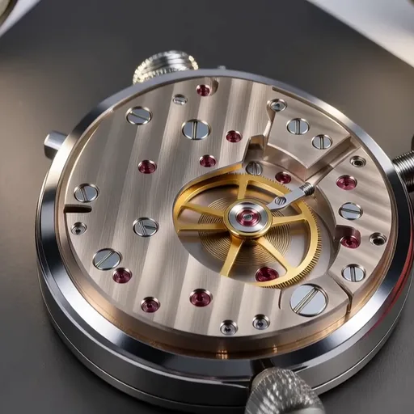

# Vimoo 1.0 workflows

Choose the workflow that matches your installed model and task. Each JSON includes its model-specific settings. Use matching nodes and local weights for the current workflows.

## Choose a workflow

| Model | Task | Workflow | Checkpoint |
|---|---|---|---|
| Vimoo-1.0 T2V | T2V | [vimoo_v1_t2v.json](vimoo_v1_t2v.json) | `vimoo_v1_t2v_bf16.safetensors` |
| Vimoo-1.0 I2V | I2V | [vimoo_v1_i2v.json](vimoo_v1_i2v.json) | `vimoo_v1_i2v_bf16.safetensors` |
| Vimoo-1.0 T2V Distilled | T2V | [vimoo_v1_t2v_distilled.json](vimoo_v1_t2v_distilled.json) | `vimoo_v1_t2v_distilled_bf16.safetensors` |
| Vimoo-1.0 I2V Distilled | I2V | [vimoo_v1_i2v_distilled.json](vimoo_v1_i2v_distilled.json) | `vimoo_v1_i2v_distilled_bf16.safetensors` |
| Vimoo-1.0-Lite TI2V | T2V / I2V | [vimoo_v1_ti2v_lite.json](vimoo_v1_ti2v_lite.json) | `vimoo_v1_lite_bf16.safetensors` |
| Vimoo-1.0-Lite TI2V Distilled | T2V / I2V | [vimoo_v1_ti2v_lite_distilled.json](vimoo_v1_ti2v_lite_distilled.json) | `vimoo_v1_lite_bf16.safetensors` |

## Install weights

Follow [Download weights](../README.md#download-weights) to download the selected checkpoint, prepare the Glyph encoder, and place the supporting encoders, VAE and any matching adapter in `ComfyUI/models/`.

| Distilled model | Adapter in `ComfyUI/models/loras/` |
|---|---|
| Vimoo-1.0 T2V Distilled | `vimoo_v1_t2v_distilled_lora_bf16.safetensors` |
| Vimoo-1.0 I2V Distilled | `vimoo_v1_i2v_distilled_lora_bf16.safetensors` |
| Vimoo-1.0-Lite TI2V Distilled | `vimoo_v1_ti2v_distilled_lora_fp32.safetensors` |

Installation instructions are in the [README](../README.md#-quick-start).

## Quick start

1. Load the matching workflow JSON in ComfyUI.
2. Select its checkpoint and any matching adapter. Preserve the saved node connections and model defaults.
3. Edit the prompt. For I2V, upload a reference image; for T2V, no image is needed.
4. Queue the workflow. Videos are saved under `ComfyUI/output/`.

The canvas has four main nodes: model loading, performance, generation and video
output. I2V adds an image input. Expand the generation subgraph to select encoder,
VAE and distilled adapter files, or edit the ordinary model's negative prompt.

Ordinary models expose steps and text CFG. The Vimoo-1.0-Lite TI2V workflow shows the CFG for
the selected T2V or I2V task. Distilled sampling settings remain fixed.

## Resolution

Choose `auto` for I2V to preserve the oriented reference image ratio within a
1280 × 720 pixel budget. Both axes round down to multiples of 16: landscape 16:9
produces 1280 × 720, portrait 9:16 produces 720 × 1280 and square produces 960 × 960.
Choose `manual` to set width and height. T2V defaults to manual 1280 × 720; auto
in Vimoo-1.0-Lite T2V mode also uses 1280 × 720 without reading an image. Extremely narrow images
that would exceed the 8192-pixel axis limit require manual dimensions.

## I2V reference image

Upload a reference image in **Vimoo TI2V Input** for Vimoo-1.0-Lite workflows or **Vimoo Load Image** for Vimoo-1.0 I2V, or copy the matching example image listed above to `ComfyUI/input/`. The image is scaled and center-cropped to the output dimensions, then encoded with the reference VAE and SigLIP. T2V skips the reference-image and vision-encoder branches.

For Vimoo-1.0 I2V, **VimooSampler** consumes connected **SIGMAS** using `sampler_name=vimoo_i2v_euler`; standalone **VimooScheduler** exposes the corresponding preset. Its workflow saves first-frame replacement on, `fps=24` and `add_fps=true`. The generation FPS connects to the output automatically.

Vimoo-1.0-Lite TI2V uses text CFG 5, reference CFG 3 and rescale 0.85 for I2V. Vimoo-1.0-Lite TI2V Distilled uses text / reference CFG 1, rescale 0 and first-frame replacement off. Keep each graph's conditioning controls and **MODEL** connections.

## Distilled workflows

The distilled versions provide three saved graphs: Vimoo-1.0 T2V Distilled, Vimoo-1.0 I2V Distilled and Vimoo-1.0-Lite TI2V Distilled, which is shared by T2V and I2V. Select the graph for your model, its matching checkpoint and adapter, then edit the prompt or image. In Vimoo-1.0-Lite TI2V Distilled, changing **Vimoo TI2V Input** selects the task's adapter recipe and conditioning without changing the checkpoint or LoRA. Its saved settings keep 12 steps, flow shift 12, text/reference CFG 1 and first-frame replacement off. Their saved presets use PyTorch SDPA and disable compilation.

Each distilled graph uses one **Vimoo Text Encode** node and CFG 1, without negative conditioning. T2V uses an empty latent; I2V adds the reference image to the positive conditioning. Negative conditioning is optional on the conditioning and sampler nodes; connect it for ordinary text or reference CFG when the selected guidance requires it. **Vimoo Text Encode** exposes the maximum text length directly: 1000 for Vimoo-1.0 models, 1400 for Vimoo-1.0-Lite models.

## Runtime requirements

Use ComfyUI 0.34.0 or later with Python 3.10 or later in an NVIDIA CUDA environment. All supplied presets use PyTorch SDPA; the normal installation covers ordinary and distilled models. Install additional attention dependencies only when selecting an optional backend in **Vimoo Performance Options**; see [performance options](../docs/performance.md).

## Generation settings

The starting size is 1280 × 720 in manual/T2V mode; I2V auto uses the image ratio. The supplied frame count is 121 at 24 fps, with seed 1234. These are starting settings for each model, rather than a preset to apply to all checkpoints.

| Model | Steps | Flow shift | CFG | Guidance rescale | Image setting |
|---|---|---|---|---|---|
| Vimoo-1.0 T2V | 50 | 12 | 4.5 | 1.2 | No image |
| Vimoo-1.0 I2V | 50 | 6 | 3 | 0.5 | First-frame replacement on |
| Vimoo-1.0 T2V Distilled | 8 | 12 | 1 | 0 | No image |
| Vimoo-1.0 I2V Distilled | 8 | 6 | 1 | 0 | First-frame replacement on |
| Vimoo-1.0-Lite TI2V | 50 | 8 | T2V 4; I2V text 5 / reference 3 | 0.85 | Lite image-conditioning preset |
| Vimoo-1.0-Lite TI2V Distilled | 12 | 12 | Text / image 1 | 0 | Distilled Lite image preset; first-frame replacement off |

Vimoo-1.0 T2V, I2V and their Distilled models use text length 1000; Vimoo-1.0-Lite TI2V and its Distilled model use 1400. Keep the distilled scheduler and adapter metadata together: their saved grids are model-specific.

## Decode and output

The generation subgraph connects **Vimoo Output VAE → VAEDecode**. Enable `tiled_decode` for release tiles, or turn it off to use auto decoding. Output decode settings are:

| Workflow | Decode mode / backend | Tile height × width | Stride height × width | Video output |
|---|---|---|---|---|
| T2V / I2V | `tiled` / `comfy` | 576 × 512 | 512 × 448 | `CreateVideo → SaveVideo` |
| Lite TI2V | `tiled` / `im2col_bounded` | 256 × 256 | 192 × 192 | `Vimoo Save Video`, libx264, CRF 19 |
| T2V / I2V Distilled | `auto` / `comfy` | Automatically selected on fallback | Automatically selected on fallback | `Vimoo Save Video`, codec `auto`, CRF 19 |
| Lite TI2V Distilled | `tiled` / `comfy` | 512 × 512 | 448 × 448 | `Vimoo Save Video`, codec `auto`, CRF 19 |

With `tiled_decode` off, decoding attempts the whole video and can fall back to
automatic tiles. The release tile sizes, convolution backend and workspace budget
are fixed internally. Reference encoding has a separate loader with the same
model connection. Vimoo-1.0-Lite TI2V reserves 2 GiB for bounded im2col workspace;
weights and activations need additional memory.

For ordinary models that support variable output sizes, smaller dimensions and fewer frames can help with prompt prototyping. Width and height must be multiples of 16 and frame counts must be `4n + 1`. Vimoo-1.0-Lite TI2V requires more than one frame. Vimoo-1.0-Lite TI2V Distilled supports the same resolution controls and uses fixed noise seed 1234. Confirm each model's memory requirements before selecting a production preset.

All workflows save video to `ComfyUI/output/`. The generation FPS connects to the output automatically. Memory controls and optional attention, compilation dependencies are described in [performance options](../docs/performance.md).

## Template thumbnails

Each JSON has a same-name animated WebP preview at 512 × 512. ComfyUI's template browser plays the WebP previews in the Vimoo category. Restart ComfyUI and refresh the page after updating the nodes.

The previews are center-cropped to a square; the saved workflows generate 1280 × 720 video. For I2V, the first preview frame uses the supplied reference image. Load a template to try its scene or enter your own prompt and image.

| Vimoo-1.0 T2V | Vimoo-1.0 I2V |
|---|---|
|  |  |

| Vimoo-1.0 T2V Distilled | Vimoo-1.0 I2V Distilled |
|---|---|
|  |  |

| Vimoo-1.0-Lite TI2V · T2V | Vimoo-1.0-Lite TI2V Distilled · T2V |
|---|---|
|  |  |

## Public node configuration

Use **Vimoo Model Loader** and **Vimoo Distilled LoRA Loader** for matching weights, **Vimoo TI2V Input** for shared task selection or **Vimoo Load Image** for Vimoo-1.0 I2V references, and **Vimoo Performance Options** for attention and the compilation switch. Model placement and offload use ComfyUI's model patcher / Dynamic VRAM. BF16 is the model loader default.

Distilled graphs connect **MODEL** to their text, image and VAE nodes to select adapter-specific settings. Keep those connections when editing a graph.

## Checkpoint and adapter metadata

Keep supplied checkpoint `.vimoo.json` and adapter `.safetensors.json` files next to their weights. They record supported tasks, compatible base / adapter identities and sampling settings.

Use the checkpoint and adapter delivered for the selected workflow. Keep the workflow's scheduler and image controls consistent with the supplied metadata.
